# Automated Backup and Rotation Script with Google Drive Integration

## 1. Project Title

**Automated Backup and Rotation Script with Google Drive Integration**

---

## 2. Project Description

This project implements an automated backup management system using Bash scripting, ZIP, rclone, Google Drive, cURL, and Linux cron.

The script backs up a specified project directory, creates a timestamped ZIP archive, stores the backup locally using a structured date-based directory, uploads the backup to Google Drive, applies daily/weekly/monthly backup rotation, records all activities in a log file, and sends a success notification using a cURL POST request.

The project is designed to automate backup operations and reduce the risk of losing important project files.

---

## 3. Project Objectives

The main objectives are:

- Create a ZIP backup of a project directory.
- Generate timestamped backup filenames.
- Store backups using a `YYYY/MM/DD` directory structure.
- Upload backups to Google Drive.
- Implement daily backup retention.
- Implement weekly backup retention.
- Implement monthly backup retention.
- Automatically delete older backups.
- Maintain backup logs.
- Send a cURL notification after successful backup.
- Provide a `--no-notify` option.
- Automate backups using Linux cron.
- Keep sensitive configuration files outside GitHub.

---

## 4. Prerequisites

The following are required:

- Linux server
- Bash
- ZIP
- Unzip
- cURL
- rclone
- Google Drive account
- Git
- GitHub account
- cron/crond service

---

## 5. Technologies Used

| Technology     | Purpose                     |
|----------------|------------------------------|
| Linux          | Operating system            |
| Bash           | Backup automation           |
| ZIP            | Backup compression          |
| rclone         | Google Drive integration    |
| Google Drive   | Remote backup storage       |
| cURL           | Notification                |
| Webhook.site   | Notification testing        |
| cron           | Backup scheduling           |
| Git            | Version control              |
| GitHub         | Source code repository      |

---

## 6. Project Architecture

```text
                    Project Directory
                           |
                           v
                  backup_script.sh
                           |
             +-------------+-------------+
             |             |             |
             v             v             v
          ZIP Backup    Logging       Configuration
             |
             v
       Local Backup
             |
             v
          rclone
             |
             v
       Google Drive
             |
             v
          Rotation
       /      |       \
      /       |        \
   Daily    Weekly    Monthly
             |
             v
       cURL Notification
```

---

## 7. Installation Steps

### Step 1: Create Project Directory

Create the project directory:

```bash
mkdir -p ~/backup-project
cd ~/backup-project
```

Create the required files:

```bash
touch backup_script.sh
touch backup.conf
touch backup.log
touch README.md
```

Check the files:

```bash
ls -l
```

**Deliverable:** Project directory containing:

```text
backup-project/
├── backup_script.sh
├── backup.conf
├── backup.log
└── README.md
```
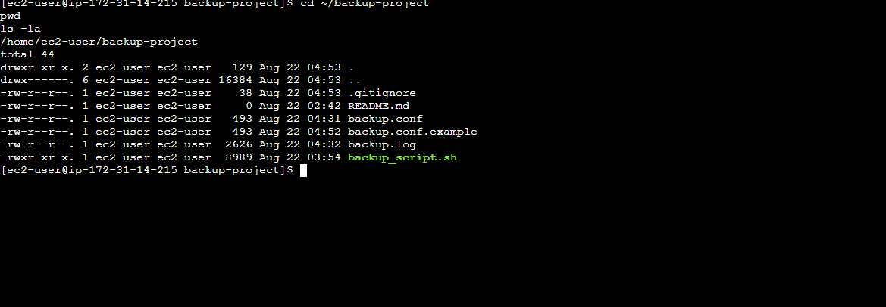

---

### Step 2: Install Required Packages

For Amazon Linux/RHEL:

```bash
sudo dnf install -y zip unzip curl
```

For Ubuntu:

```bash
sudo apt update
sudo apt install -y zip unzip curl
```

Verify:

```bash
zip -v
unzip -v
curl --version
```

**Deliverable:** Required backup utilities installed successfully.

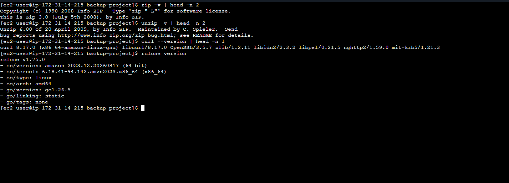

---

### Step 3: Install rclone

Install rclone:

```bash
curl https://rclone.org/install.sh | sudo bash
```

Verify:

```bash
rclone version
```

**Deliverable:** rclone installed successfully.

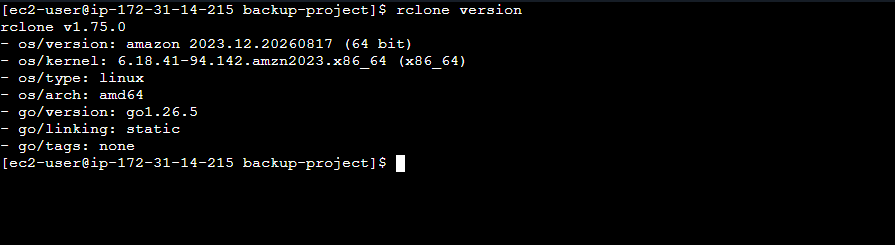

---

### Step 4: Configure Google Drive

Run:

```bash
rclone config
```

Create a new remote: `n`

Set the remote name: `gdrive`

Select Google Drive and complete authentication.

Verify:

```bash
rclone listremotes
```

Expected:

```text
gdrive:
```

Test:

```bash
rclone lsd gdrive:
```

**Deliverable:** Google Drive successfully configured as the `gdrive` rclone remote.

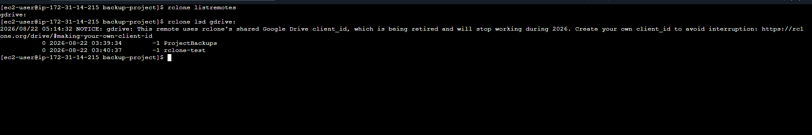

---

### Step 5: Create Google Drive Backup Folder

Create the backup folder:

```bash
rclone mkdir gdrive:ProjectBackups
```

Verify:

```bash
rclone lsd gdrive:
```

**Deliverable:** Google Drive folder: `ProjectBackups`

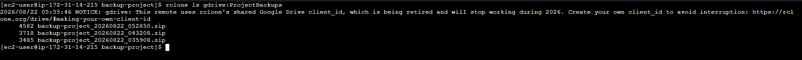


---

### Step 6: Configure backup.conf

The project uses an external configuration file.

Example:

```bash
PROJECT_NAME="backup-project"

SOURCE_DIR="/home/ec2-user/backup-project"

BACKUP_BASE="$HOME/backups"

RCLONE_REMOTE="gdrive"

DRIVE_FOLDER="ProjectBackups"

DAILY_RETENTION=7
WEEKLY_RETENTION=4
MONTHLY_RETENTION=3

NOTIFY_ENABLED=true

WEBHOOK_URL="YOUR_WEBHOOK_URL"
```

> The actual configuration contains the private webhook URL and is not committed to GitHub.

**Deliverable:** `backup.conf` configured for:

- Project name
- Source directory
- Local backup directory
- Google Drive remote
- Google Drive folder
- Retention settings
- Notification settings

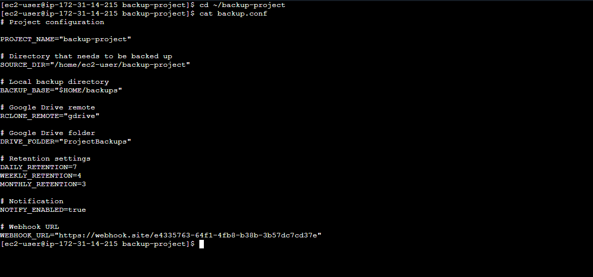

---

### Step 7: Create Backup Script

The main script is `backup_script.sh`.

The script performs:

- Configuration loading
- Configuration validation
- Timestamp generation
- ZIP creation
- Local backup storage
- Google Drive upload
- Daily rotation
- Weekly rotation
- Monthly rotation
- Logging
- cURL notification
- `--no-notify` option

**Deliverable:** `backup_script.sh`

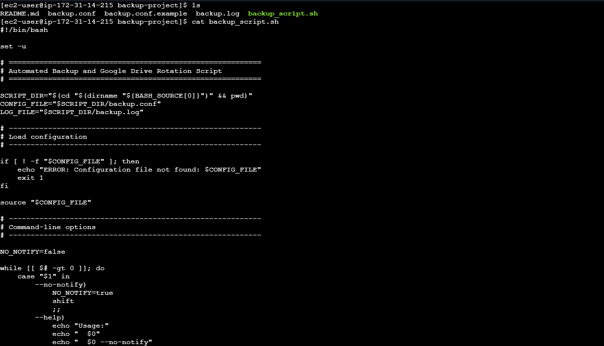

### Step 8: Give Execute Permission

Run:

```bash
chmod +x backup_script.sh
```

Verify:

```bash
ls -l backup_script.sh
```

The file should have execute permission.

**Deliverable:** Executable backup script.

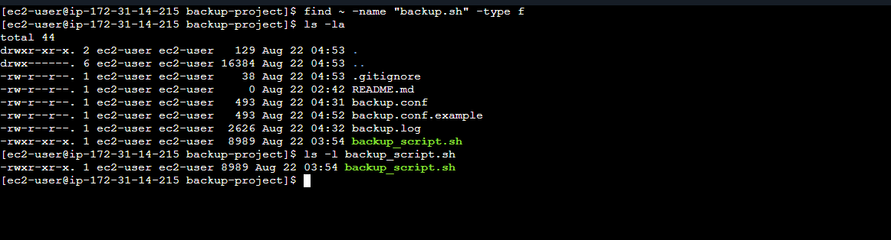


---

### Step 9: Validate Source Directory

Check the configured source directory:

```bash
source backup.conf
echo "$SOURCE_DIR"
```

Expected:

```text
/home/ec2-user/backup-project
```

Check files:

```bash
ls -la "$SOURCE_DIR"
```

**Deliverable:** Source project directory successfully validated.

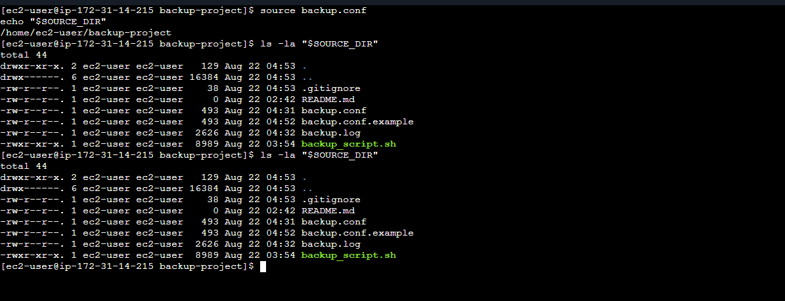

---

### Step 10: Run Backup Manually

Run:

```bash
./backup_script.sh
```

The script:

```text
Creates ZIP
      |
      v
Stores local backup
      |
      v
Uploads to Google Drive
      |
      v
Runs rotation
      |
      v
Sends notification
```

**Deliverable:** Successful backup execution.

Example:

```text
ZIP backup created successfully.
Google Drive upload successful.
Backup rotation completed.
Notification sent successfully.
Backup completed successfully.
```

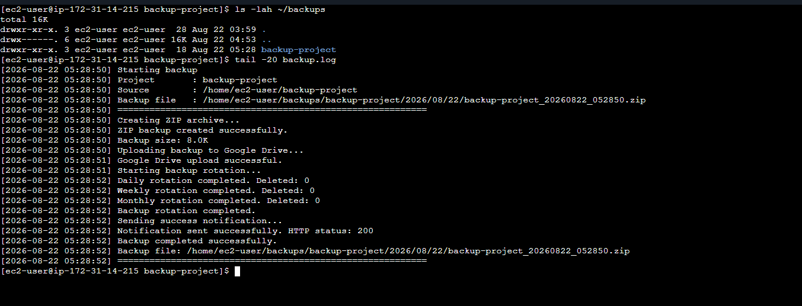


---

### Step 11: Verify Local Backup

Check backups:

```bash
find ~/backups -type f
```

Expected format:

```text
/home/ec2-user/backups/backup-project/2026/08/22/backup-project_20260822_035908.zip
```

The directory structure is:

```text
~/backups/
└── backup-project/
    └── 2026/
        └── 08/
            └── 22/
                └── backup-project_YYYYMMDD_HHMMSS.zip
```

**Deliverable:** Timestamped local ZIP backup.

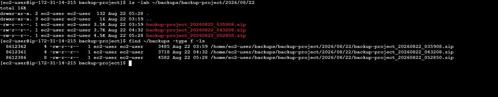


---

### Step 12: Verify ZIP Contents

Run:

```bash
unzip -l ~/backups/backup-project/2026/08/22/*.zip
```

The ZIP contains the project files. The `.git` directory is excluded by the backup script.

**Deliverable:** Valid ZIP archive containing the project files.

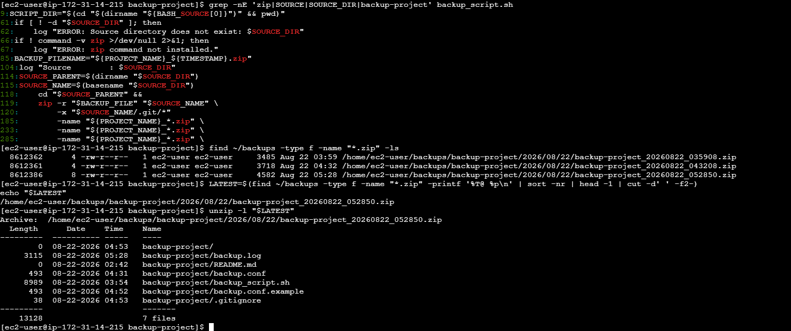


---

### Step 13: Verify Google Drive Upload

Run:

```bash
rclone ls gdrive:ProjectBackups
```

The uploaded ZIP file should be displayed.

**Deliverable:** Backup successfully uploaded to Google Drive.


---

### Step 14: Test Notification

Configure:

```bash
WEBHOOK_URL="YOUR_WEBHOOK_URL"
```

Run:

```bash
./backup_script.sh
```

The script sends a POST request to the webhook.

Expected JSON:

```json
{
  "project": "backup-project",
  "date": "2026-08-22 04:32:28",
  "test": "BackupSuccessful"
}
```

The successful execution produced:

```text
Notification sent successfully. HTTP status: 200
```

**Deliverable:** Successful cURL notification.

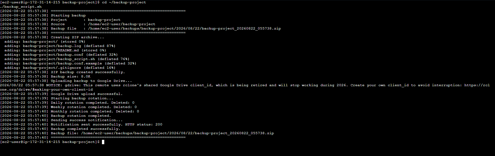

---

### Step 15: Test --no-notify

Run:

```bash
./backup_script.sh --no-notify
```

The backup and Google Drive upload still execute, but the notification is disabled.

Expected log:

```text
Notification disabled.
```

**Deliverable:** `--no-notify` option successfully tested.

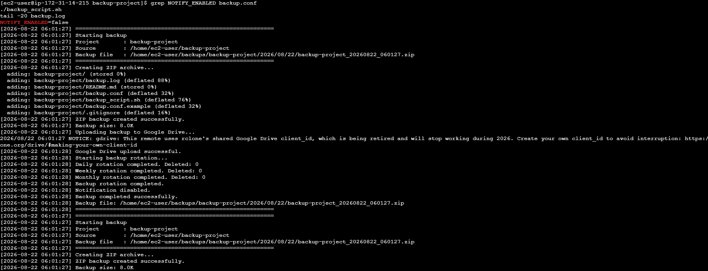


---

### Step 16: Test Backup Rotation

The configuration uses:

```bash
DAILY_RETENTION=7
WEEKLY_RETENTION=4
MONTHLY_RETENTION=3
```

**Daily Rotation**
The script keeps the newest 7 backup files. Older files are automatically deleted.

**Weekly Rotation**
On Sunday, the backup is copied to `~/backups/backup-project/.weekly/`. The latest 4 weekly backups are retained.

**Monthly Rotation**
On the first day of the month, the backup is copied to `~/backups/backup-project/.monthly/`. The latest 3 monthly backups are retained.

**Deliverable:** Daily, weekly, and monthly retention logic implemented.

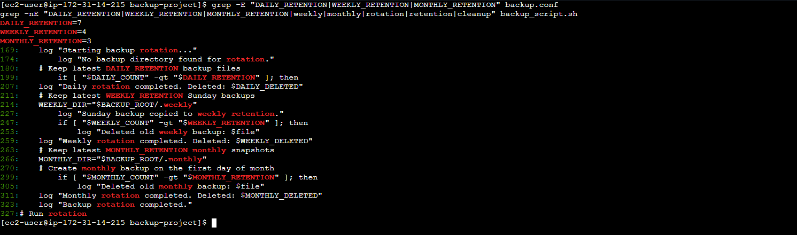

---

### Step 17: Verify Logs

View the backup log:

```bash
cat backup.log
```

Or:

```bash
tail -f backup.log
```

The log records:

- Backup time
- Project name
- Source directory
- Backup file
- Backup size
- Google Drive upload status
- Rotation status
- Deleted backups
- Notification status
- Final result

**Deliverable:** Backup logging implemented.

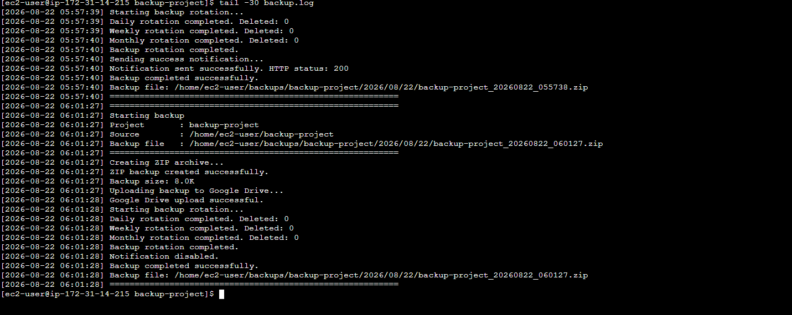

---

### Step 18: Configure Cron

Check cron service:

```bash
systemctl status crond
```

The service should be active.

Open the user's crontab:

```bash
crontab -e
```

Add:

```cron
0 2 * * * /home/ec2-user/backup-project/backup_script.sh >> /home/ec2-user/backup-project/backup.log 2>&1
```

This runs the backup every day at 2:00 AM.

Verify:

```bash
crontab -l
```

**Deliverable:** Automated daily backup scheduling.
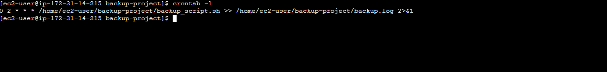

---

### Step 19: Test Cron

For testing, the cron job can temporarily run every 5 minutes:

```cron
*/5 * * * * /home/ec2-user/backup-project/backup_script.sh --no-notify >> /home/ec2-user/backup-project/cron.log 2>&1
```

After testing, restore:

```cron
0 2 * * * /home/ec2-user/backup-project/backup_script.sh
```

**Deliverable:** Cron scheduling tested successfully.


### Step 20: Create .gitignore

Create:

```bash
vi .gitignore
```

Add:

```text
backup.conf
backup.log
cron.log
*.zip
```

This prevents sensitive configuration, logs, and backup archives from being pushed to GitHub.

**Deliverable:** `.gitignore` created.

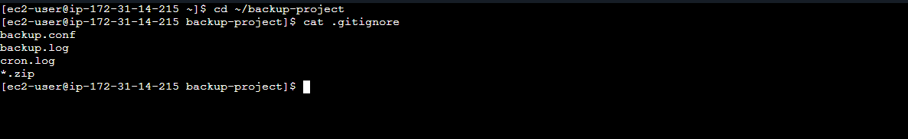


---

### Step 21: Create backup.conf.example

Create:

```bash
cp backup.conf backup.conf.example
```

Edit:

```bash
vi backup.conf.example
```

Replace the real webhook URL with:

```bash
WEBHOOK_URL="YOUR_WEBHOOK_URL"
```

The example configuration can safely be committed to GitHub.

**Deliverable:** Safe configuration template: `backup.conf.example`

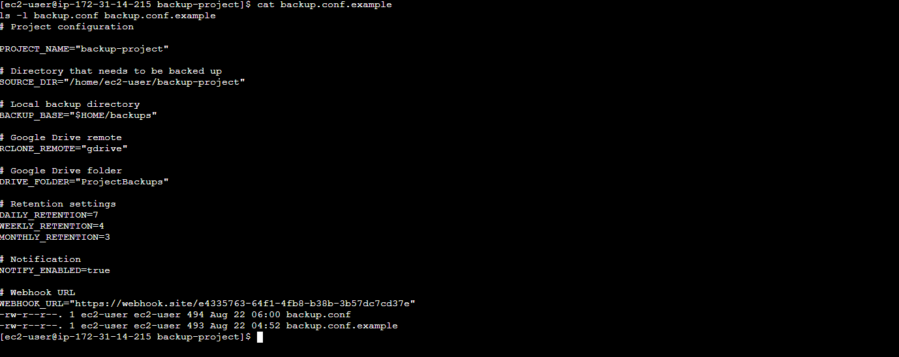


## 8. Project Structure

```text
automated-backup-rotation/
│
├── backup_script.sh
├── backup.conf.example
├── README.md
├── .gitignore
│
└── screenshots/
    ├── 01-project-setup.png
    ├── 02-packages.png
    ├── 03-rclone-install.png
    ├── 04-rclone-config.png
    ├── 05-google-drive-folder.png
    ├── 06-backup-config.png
    ├── 07-backup-script.png
    ├── 08-execute-permission.png
    ├── 09-source-directory.png
    ├── 10-backup-success.png
    ├── 11-local-backup.png
    ├── 12-zip-content.png
    ├── 13-google-drive-upload.png
    ├── 14-webhook-notification.png
    ├── 15-no-notify.png
    ├── 16-rotation.png
    ├── 17-backup-log.png
    ├── 18-cron.png
    ├── 19-cron-test.png
    ├── 20-gitignore.png
    ├── 21-config-example.png
```
## 9. Implementation Steps

The implementation consists of:

1. Linux environment preparation.
2. Required package installation.
3. rclone installation.
4. Google Drive configuration.
5. Google Drive backup folder creation.
6. Backup configuration.
7. Bash backup script creation.
8. ZIP archive creation.
9. Local backup storage.
10. Google Drive upload.
11. Daily backup rotation.
12. Weekly backup rotation.
13. Monthly backup rotation.
14. Backup logging.
15. cURL notification.
16. `--no-notify` option.
17. Cron scheduling.
18. Git version control.
19. GitHub deployment.

-
## 11. Deliverables

The completed project contains:

- `backup_script.sh`
- `backup.conf.example`
- `README.md`
- `.gitignore`
- Google Drive integration using rclone
- Timestamped ZIP backups
- Local backup storage
- Daily rotation
- Weekly rotation
- Monthly rotation
- Backup logging
- cURL notification
- `--no-notify` option
- Cron scheduling
- Git repository
- GitHub repository
- Implementation screenshots

---

## 12. Results

The backup system successfully:

- Created ZIP backups.
- Generated timestamped filenames.
- Stored backups in the required date-based directory.
- Uploaded backups to Google Drive.
- Applied backup rotation policies.
- Generated backup logs.
- Sent successful cURL notifications.
- Supported notification disabling with `--no-notify`.
- Supported automated scheduling using cron.
- Protected sensitive configuration using `.gitignore`.
- Was pushed to GitHub.

Example successful execution:

```text
ZIP backup created successfully.
Backup size: 4.0K
Google Drive upload successful.
Daily rotation completed. Deleted: 0
Weekly rotation completed. Deleted: 0
Monthly rotation completed. Deleted: 0
Backup rotation completed.
Notification sent successfully. HTTP status: 200
Backup completed successfully.
```

---

## 13. Backup Example

Local backup:

```text
/home/ec2-user/backups/backup-project/2026/08/22/backup-project_20260822_043208.zip
```

Google Drive:

```text
gdrive:ProjectBackups/
└── backup-project_20260822_043208.zip
```

---

## 14. Security Considerations

The following files must not be committed to GitHub:

- `backup.conf`
- `backup.log`
- `cron.log`
- `*.zip`

The real webhook URL should remain private.

The repository should contain `backup.conf.example` instead of the real configuration.

Google Drive authentication is handled by rclone rather than storing Google credentials inside the Bash script.

---

## 15. Troubleshooting

**Check rclone**

```bash
rclone listremotes
```

**Check Google Drive**

```bash
rclone lsd gdrive:
```

**Check backup files**

```bash
find ~/backups -type f
```

**Check ZIP contents**

```bash
unzip -l ~/backups/backup-project/2026/08/22/*.zip
```

**Check logs**

```bash
tail -f backup.log
```

**Check cron**

```bash
systemctl status crond
crontab -l
```

**Check script permissions**

```bash
ls -l backup_script.sh
```

---

## 16. Conclusion

This project demonstrates a complete automated backup solution using Linux Bash scripting.

The system automatically creates timestamped ZIP archives, stores them locally, uploads them to Google Drive using rclone, applies daily/weekly/monthly retention policies, records backup activities in logs, sends success notifications through cURL, and schedules backups using cron.

The project also follows basic security practices by keeping sensitive configuration information out of the GitHub repository.

This solution can be extended in the future with AWS S3, email/SNS notifications, encryption, monitoring, failure alerts, and centralized logging.
